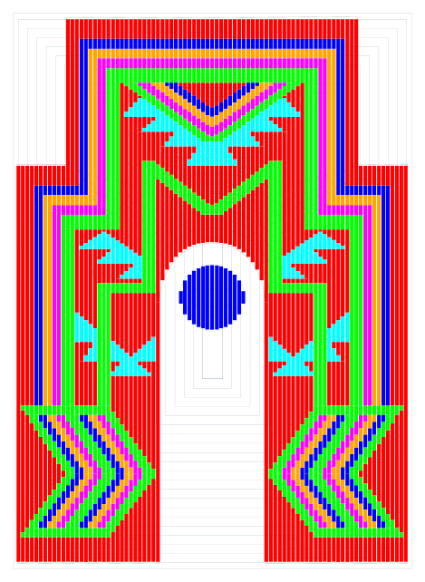
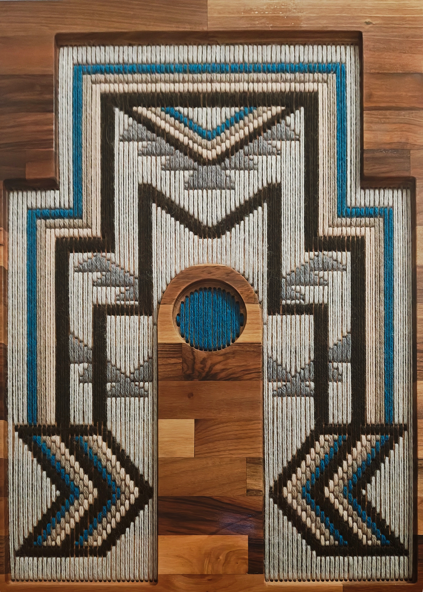

# `svgcode` 🧶✨

Welcome to **svgcode**—the ultimate digital wizardry that bridges the gap between vector graphics and the satisfying hum of a CNC router. Tired of overly complicated CNC software suites? This utility takes your vector graphics and turns them into pristine, optimized g-code ready to bring your physical creations to life. 

---

## What is `svgcode`?

`svgcode` is a command line utility that can make cnc/gcode generation easier. This tool allows you to define your requirements in an SVG editor, provide instructions to the tool via simple JSON format, and generate optimized g-code files that can follow paths and drill holes. Can provide instructions to output g-code by following paths of SVG `<path>` elements found under root SVG nodes (or layers). Can provide instructions to output g-code for drilling holes at SVG `<circle>` elements found under root SVG nodes or drill points at the start and end of SVG `<path>` elements in the same way.

---

## Example Project: Aztec Yarn Art Panel

This example walks through setting up a project using a CNC router to cut out regions in a wood panel (handling both front and back operations) and drilling precise holes at line segment start and ends. These holes allow you to string vibrant yarn between them, completing a visually striking, multi-dimensional wall hanging.

### Step 1: Generate your SVG
Create an SVG vector graphic containing all the paths and markers you want to convert into g-code. Ensure your vector dimensions, layers, and geometry match the actual physical tool head sizes and dimensions you plan to use on your CNC machine.



### Step 2: Define your Configuration JSON
Create a configuration JSON file to control how `svgcode` parses your vector data and generates the matching machine instructions.


**`config.json` Example:**
[Aztec Yarn Art Example Configuration](example/aztec-cnc-config.json)
```json
[
    {
        "input": "./aztec-yarn-art-full.svg",
        "output": "./aztec-yarn-art-cnc-holes.gcode",
        "drillZ": -40,
        "drillRoots": [
            {
                "name": "front-holes-lines-1"
            },
            {
                "name": "front-holes-lines-2"
            },
            {
                "name": "front-holes-lines-3"
            },
            {
                "name": "front-holes-lines-4"
            },
            {
                "name": "front-holes-lines-5"
            },
            {
                "name": "front-holes-lines-6"
            }
        ]
    },
    {
        "input": "./aztec-yarn-art-full.svg",
        "output": "./aztec-yarn-art-cnc-front-outer.gcode",
        "pathZ": -5,
        "pathRoots": [
            {
                "name": "front-depth-outer"
            }
        ]
    },
    {
        "input": "./aztec-yarn-art-full.svg",
        "output": "./aztec-yarn-art-cnc-front-inner.gcode",
        "pathZ": -5,
        "pathRoots": [
            {
                "name": "front-depth-inner"
            }
        ]
    },
    {
        "input": "./aztec-yarn-art-full.svg",
        "output": "./aztec-yarn-art-cnc-back-outer.gcode",
        "pathZ": -5,
        "pathRoots": [
            {
                "name": "back-depth-outer"
            }
        ]
    },
    {
        "input": "./aztec-yarn-art-full.svg",
        "output": "./aztec-yarn-art-cnc-back-inner.gcode",
        "pathZ": -5,
        "pathRoots": [
            {
                "name": "back-depth-inner"
            }
        ]
    }
]

```

#### Configuration Notes:
* **`output`**: Each configuration section defines an input SVG and output g-code. These are purposefully split into their own g-code files to allow for board orientation changes (front vs back) or tool changes (path vs drill).
* **`drillRoots`**: Defines SVG element id/labels that act as roots for child SVG path/circle elements to use for drilling
* **`pathRoots`**: Defines SVG element id/labels that act as roots for child SVG path/circle elements to use for carving paths
* **`drillZ`**: Defines the 'Z' value when drilling holes. Can also be defined on `drillRoots`
* **`pathZ`**: Defines the 'Z' value when carving paths. Can also be defined on `pathRoots`

See [Config Syntax](./svgcode-syntax.ts) for full usage/details.

---

### Step 3: Run the Tool
Execute the generation script via Node.js using your configuration file as the input argument:

```bash
node svgcode.ts '<path to config>/aztec-cnc-config.json'
```

---

### Step 4: Validate and Verify G-Code
Before sending any code to your physical machine, always verify and simulate your generated files using trusted online gcode viewers like [NCViewer](https://ncviewer.com/) to ensure toolpaths, depths, and sequences are completely accurate.

#### Resulting Output Files:
* [Front Outer gcode](./example/aztec-yarn-art-cnc-front-outer.gcode) - 1/2" bullnose bit
* [Front Cutout gcode](./example/aztec-yarn-art-cnc-front-inner.gcode) - 1/2" flat bit
* [Back Outer gcode](./example/aztec-yarn-art-cnc-back-outer.gcode) - 1/2" bullnose bit
* [Back Cutout gcode](./example/aztec-yarn-art-cnc-back-inner.gcode) - 1/2" flat bit
* [Holes gcode](./example/aztec-yarn-art-cnc-holes.gcode) - 1/8" flat bit

---

### Example Result
